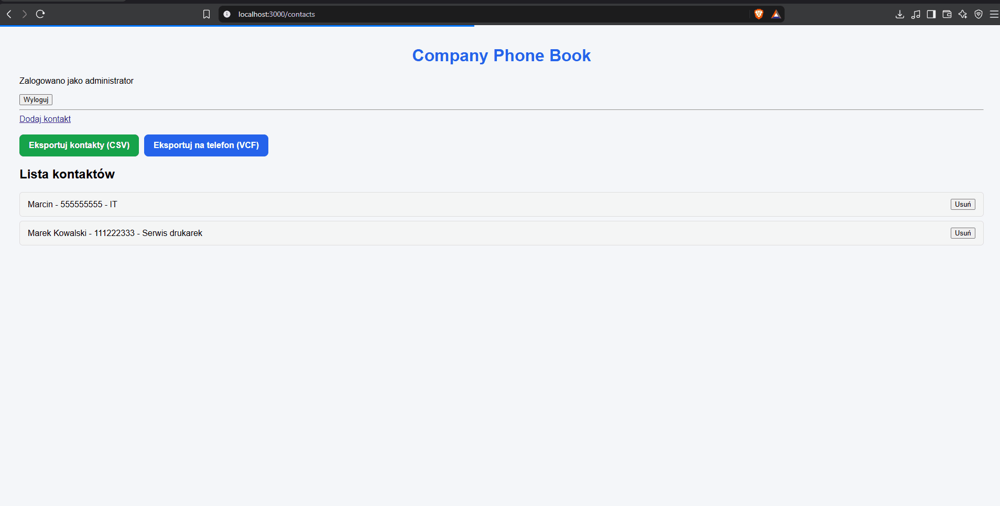

1.company-contacts jest to projekt rozwiązujący problem w wielu firmach jakim jest brak kontaktów dla nowych pracowników,
wyobraźmy sobię sytuację kiedy nowy pracownik musi skontaktować się z działem IT bądź z zewnętrznymi usługami w firmie - 
pojawią się problem, gdyż nie ma do nich numeru telefonu. Moja aplikacja rozwiązuje ten problem użytkownicy tworzą publiczną 
listę numerów telefonów, którą następnie można pobrać w formacie CSV, lub w formacie VCF (dla telefonów) a następnie zaimportować kontakty, bardzo to ułatwia proces zapisywania wszystkich kontaktów dla nowych pracowników i nie tylko.
2.Pogląd
## Podgląd aplikacji

3.Technologie:
- Ruby
- Ruby on Rails 8.1
- SQLite
- HTML/ERB
- CSS

4.Uruchomienie 

5.funckjonalności
- dodawanie kontaktów
- usuwanie kontaktów (tylko admin)
- eksport CSV lub VCF